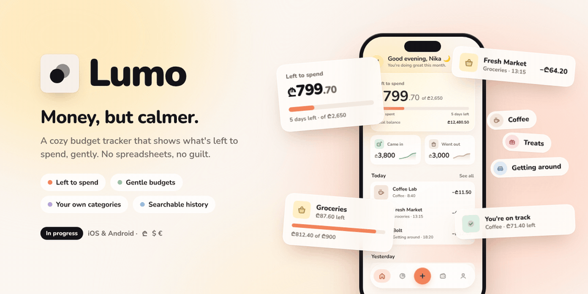
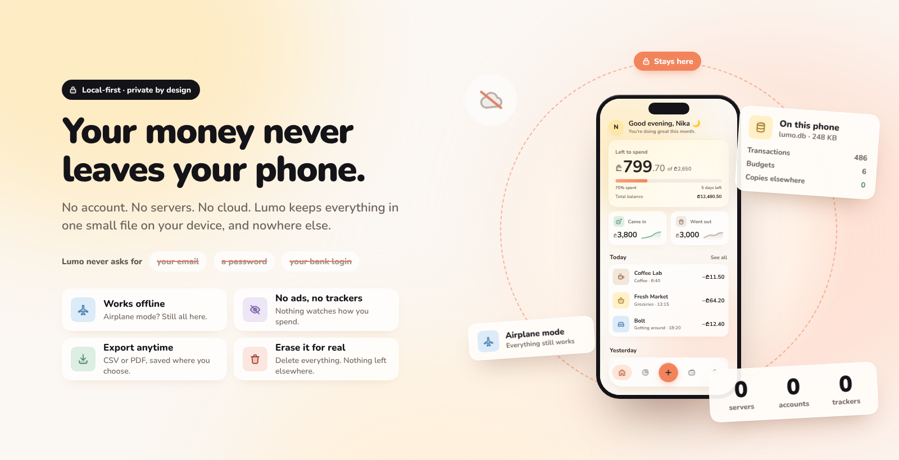
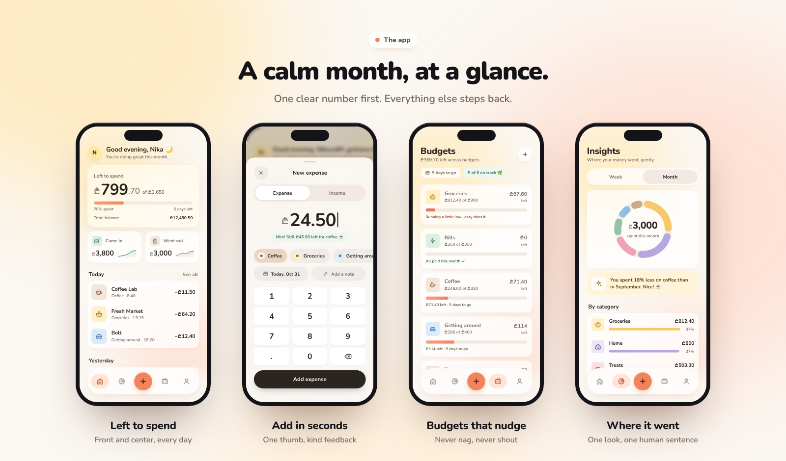
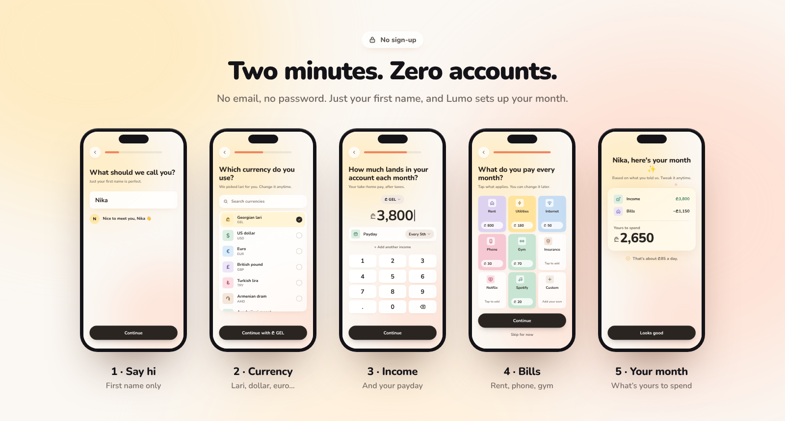
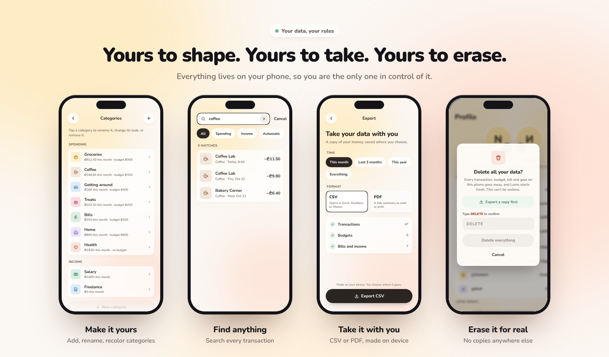

<p align="center"></p>

<h1 align="center">Lumo</h1>
<p align="center"><b>Money, but calmer.</b><br>A cozy budget tracker that shows what's left to spend, gently. No spreadsheets, no guilt.</p>

<p align="center">
  
  
  
</p>

---

## Why Lumo?

Most finance apps feel like a bank form or a busy dashboard. Lumo is the opposite. Opening it should feel like exhaling.

It answers one question first: **how much can I still spend this month?** Everything else steps back. The tone is warm and human, the numbers are clear, and nothing is shouting at you in red.

## Your money never leaves your phone

<p align="center"></p>

No account. No servers. No cloud. Lumo keeps everything in one small SQLite file on your device, and nowhere else. It never asks for your email, a password or your bank login.

- **Works offline.** Airplane mode? Still all here.
- **No ads, no trackers.** Nothing watches how you spend.
- **Yours to take or erase.** Export or delete everything, see [Your data, your rules](#your-data-your-rules).

## Features

<p align="center"></p>

- **Left to spend:** front and center, every day. One clear number on the Home screen with a soft progress bar and the days left, then what came in, what went out, and today's transactions.
- **Add in seconds:** a bottom sheet with a big amount, a number pad, Expense / Income switch, category chips, date and note. Fast with one thumb, with kind feedback like _"Nice! Still ₾46.90 left for coffee"_.
- **Budgets that nudge:** never nag, never shout. Per-category budgets with friendly notes like _"Running a little low · easy does it"_ and _"All paid this month ✓"_. Bars warm up as you get close to a limit.
- **Where it went:** Insights shows a donut by category with Week / Month views, plus one human sentence like _"You spent 18% less on coffee than in September. Nice!"_
- **Multiple currencies:** Georgian lari (₾) by default, plus US dollar, euro and more.

## Set up in two minutes, without an account

<p align="center"></p>

No email, no password. Just your first name, and Lumo sets up your month:

1. **Say hi:** first name only.
2. **Currency:** lari, dollar, euro and more.
3. **Income:** what lands in your account, and your payday.
4. **Bills:** rent, phone, gym. Tap what applies.
5. **Your month:** _"Nika, here's your month ✨"_. Income minus bills is what's yours to spend.

## Your data, your rules

<p align="center"></p>

Everything lives on your phone, so you are the only one in control of it. These screens are designed and coming soon.

- **Make it yours:** add, rename and recolor categories.
- **Find anything:** search every transaction.
- **Take it with you:** export to CSV or PDF, made on the device.
- **Erase it for real:** type DELETE to remove every transaction, budget and bill. No copies anywhere else.

## Design principles

- **One hero per screen.** Each screen has one thing that matters most; everything else is quieter.
- **Warm, not corporate.** Cream background, soft butter and peach light, rounded type and squircle corners.
- **One accent, used sparingly.** Peach appears only for the main action, the active tab and budget progress.
- **Kind words.** Microcopy encourages instead of judging: _"That's okay, it happens."_
- **Readable for everyone.** Text aims for WCAG AA contrast, and motion respects _Reduce Motion_.

## Getting started

> Lumo is in active development. You need Node 22+, and for simulators Xcode and/or Android Studio.

```bash
git clone https://github.com/asyncfinkd/lumo.git
cd lumo
npm install
```

```bash
npm run ios       # iOS simulator (Expo Go)
npm run android   # Android emulator (Expo Go)
npm start         # QR code for Expo Go on a real phone
```

Before opening a PR (CI runs the same checks):

```bash
npm run typecheck
npm run lint
npm run format:check
npm test
```

Changing the database: edit `src/db/schema.ts`, run `npm run db:generate`, and commit the new migration in `src/db/migrations/`. In development an empty database is filled with [docs/sample-data.md](docs/sample-data.md).

### Install on an Android phone

Lumo ships to a real phone as an APK built by [EAS](https://docs.expo.dev/eas/). Your data lives in a SQLite file inside the app, so installing a newer build over the old one, or receiving an update, keeps it. Uninstalling the app deletes it.

One-time setup (writes `updates.url` and `extra.eas.projectId` to `app.json`; commit that change):

```bash
npx eas-cli@latest login
npx eas-cli@latest update:configure
```

Build the APK, then open the link EAS prints on the phone and install it:

```bash
npx eas-cli@latest build --profile preview --platform android
```

Ship JavaScript changes (screens, logic, new migrations) without reinstalling. The app picks the update up on its next launch:

```bash
npx eas-cli@latest update --channel preview --message "What changed"
```

Native changes (a new library with native code, an SDK upgrade, native settings in `app.json`) change the runtime fingerprint, so they need a new build instead of an update. Install it over the existing app.

How we work: [CONTRIBUTING.md](CONTRIBUTING.md). Decisions: [docs/adr](docs/adr).

## Roadmap

- [x] Home, Add transaction, Insights and Budgets designs
- [x] Onboarding flow
- [x] App icon
- [ ] Core app (in progress)
- [ ] "Safe to spend today" daily number
- [ ] Upcoming bills strip
- [ ] Monthly recap story
- [ ] Dark mode
- [ ] Categories, search, export and delete-all
- [ ] Savings jars
- [ ] Alternate app icons (dark and orange)
- [ ] Georgian language (ქართული)

## Contributing

Ideas, feedback and pull requests are welcome. If you have a suggestion, please [open an issue](../../issues) first so we can talk it through.

## License

MIT
