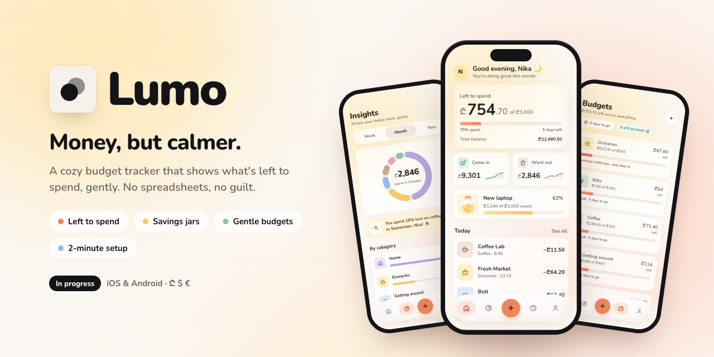

<p align="center"></p>

<h1 align="center">Lumo</h1>
<p align="center"><b>Money, but calmer.</b><br>A cozy budget tracker that shows what's left to spend, gently. No spreadsheets, no guilt.</p>

<p align="center">
  
  
  
</p>

---

## Why Lumo?

Most finance apps feel like a bank form or a busy dashboard. Lumo is the opposite. Opening it should feel like exhaling.

It answers one question first: **how much can I still spend this month?** Everything else steps back. The tone is warm and human, the numbers are clear, and nothing is shouting at you in red.

## Features

- **Left to spend:** one clear number on the Home screen, with a soft progress bar and the days left in the month.
- **Quick add:** a bottom sheet with a big amount, a number pad, Expense / Income switch and category chips. Fast to use with one thumb.
- **Gentle budgets:** per-category budgets with friendly notes like _"Plenty left · treat yourself"_. Bars warm up as you get close to a limit; no harsh warnings.
- **Insights:** a clean donut chart by category with Week / Month / Year views, plus one human sentence about your month.
- **Savings jars:** set a goal, see it fill up, and know when you'll get there.
- **2-minute setup:** onboarding asks one question per screen: name, currency, income, monthly bills and an optional savings goal. Then it reveals your month: _"Here's what's yours to spend."_
- **Multiple currencies:** Georgian lari (₾) by default, plus US dollar, euro and more.
- **Alternate app icons:** a light default icon, with dark and orange versions to choose from.

## Design principles

- **One hero per screen.** Each screen has one thing that matters most; everything else is quieter.
- **Warm, not corporate.** Cream background, soft butter and peach light, rounded type and squircle corners.
- **One accent, used sparingly.** Peach appears only for the main action, the active tab and budget progress.
- **Kind words.** Microcopy encourages instead of judging: _"That's okay, it happens."_
- **Readable for everyone.** Text aims for WCAG AA contrast, and motion respects _Reduce Motion_.

## Getting started

> Lumo is in active development. You need Node 22+, and for simulators Xcode and/or Android Studio.

```bash
git clone https://github.com/asyncfinkd/lumo.git
cd lumo
npm install
```

```bash
npm run ios       # iOS simulator (Expo Go)
npm run android   # Android emulator (Expo Go)
npm start         # QR code for Expo Go on a real phone
```

Before opening a PR (CI runs the same checks):

```bash
npm run typecheck
npm run lint
npm run format:check
npm test
```

How we work: [CONTRIBUTING.md](CONTRIBUTING.md). Decisions: [docs/adr](docs/adr).

## Roadmap

- [x] Home, Add transaction, Insights and Budgets designs
- [x] Onboarding flow
- [x] App icon
- [ ] Core app (in progress)
- [ ] "Safe to spend today" daily number
- [ ] Upcoming bills strip
- [ ] Monthly recap story
- [ ] Dark mode
- [ ] Georgian language (ქართული)

## Contributing

Ideas, feedback and pull requests are welcome. If you have a suggestion, please [open an issue](../../issues) first so we can talk it through.

## License

MIT
